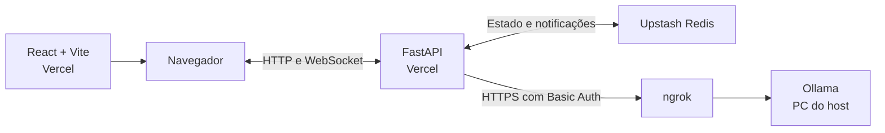

# quiZeZ

**Quiz multiplayer em tempo real com perguntas geradas por IA.**

Projeto pessoal de um jogo em português para jogar com amigos no navegador. O host cria uma sala e compartilha o convite. Cada jogador entra com um nome, sem criar conta. O diferencial é que a pergunta é gerada na hora, a partir do tema e da dificuldade escolhidos no turno.

[Como jogar](#como-jogar) · [IA generativa](#ia-generativa) · [Arquitetura](#arquitetura) · [Rodar localmente](#rodar-localmente) · [Deploy](#deploy)

## Como jogar

1. **Crie uma sala.** O host define a meta de pontos e o tempo por pergunta, compartilha o código ou o convite e inicia a partida.
2. **Escolha e responda.** O primeiro jogador é sorteado entre os conectados. Em cada turno, o jogador da vez escolhe um de cinco temas sorteados e uma dificuldade. Com a pergunta pronta, ele responde antes de o tempo acabar.
3. **Dispute o placar.** Um acerto soma pontos; um erro ou o fim do tempo vale zero. Quem alcança a meta vence. O host pode iniciar outra partida com o placar zerado.

| Dificuldade | Pontos por acerto | Após trocar a pergunta |
| --- | ---: | ---: |
| Fácil | 1 | 1 |
| Médio | 2 | 1 |
| Difícil | 3 | 2 |

O jogador da vez pode trocar a pergunta uma vez, mantendo o tema e a dificuldade. Uma troca bem-sucedida reinicia o cronômetro e reduz o valor da pergunta em um ponto, com mínimo de um. Por padrão, são **30 segundos** para responder e **25 pontos** para vencer. O host pode configurar esses valores entre 5 e 180 segundos e entre 1 e 100 pontos.

Quem entra no meio da partida vai para o fim da fila. Em caso de queda, o jogador tem dez segundos para voltar depois que o servidor detecta a desconexão. Jogadores offline são pulados na rotação, mas mantêm o placar. O host pode remover um jogador mediante confirmação.

## IA generativa

O [Ollama](https://docs.ollama.com/) executa o modelo de linguagem no computador do host. O modelo padrão é o [Llama 3.1 8B](https://ollama.com/library/llama3.1:8b). A geração segue este fluxo:

1. O FastAPI monta o prompt com o tema, instruções específicas da dificuldade e até dez perguntas anteriores da sala para reduzir repetições.
2. O modelo responde com o enunciado, quatro alternativas e a resposta correta em JSON. O backend valida os campos, rejeita alternativas repetidas, verifica se a resposta correta está na lista e embaralha as opções.
3. O servidor publica a pergunta sem revelar a resposta correta e inicia o cronômetro. Um resultado que chega depois de o turno mudar é descartado.

O backend faz até três tentativas de geração. Se não conseguir gerar a pergunta inicial, o jogador pode **Tentar novamente** no mesmo tema e dificuldade. Se uma troca falhar, a pergunta anterior volta com o tempo que restava e a troca continua disponível. O modo `fake` é separado e permite experimentar o jogo sem modelo.

A validação garante a estrutura da pergunta, mas não verifica se a informação gerada é verdadeira. O modelo ainda pode cometer erros factuais.

## Arquitetura



**Interface:** React, Vite e CSS. O navegador envia ações por HTTP e recebe atualizações da sala por WebSocket.

**Servidor:** Python e FastAPI. O servidor controla os turnos, a pontuação e os prazos. Um token de sessão por jogador autentica ações e permite reconectar sem conta.

**Estado compartilhado:** o Redis guarda salas, placar e prazos. Atualizações atômicas evitam que ações simultâneas sobrescrevam o estado umas das outras. O Redis também notifica conexões em instâncias diferentes. No desenvolvimento local, o jogo pode usar apenas a memória de um processo.

**Validação:** o deploy foi testado com três jogadores simultâneos em dois aparelhos, usando uma janela normal, uma anônima e um celular.

## Rodar localmente

**Requisitos:** Python 3.11+ e Node.js 22.12+. Para experimentar o jogo no modo de demonstração, não é necessário instalar Ollama, configurar Redis ou criar um `.env`.

Na raiz do repositório:

**Windows (PowerShell)**

```powershell
python -m venv .venv
.\.venv\Scripts\python.exe -m pip install -r requirements.txt
npm.cmd --prefix frontend ci
npm.cmd --prefix frontend run build
.\.venv\Scripts\python.exe -m uvicorn app.main:app --reload
```

**Linux e macOS**

```bash
python3 -m venv .venv
./.venv/bin/python -m pip install -r requirements.txt
npm --prefix frontend ci
npm --prefix frontend run build
./.venv/bin/python -m uvicorn app.main:app --reload
```

Abra o [jogo](http://127.0.0.1:8000/) em uma janela normal e outra anônima para simular dois jogadores. A [documentação da API](http://127.0.0.1:8000/docs) e o [status do servidor](http://127.0.0.1:8000/health) também estão disponíveis localmente. Ao alterar o React, execute o build novamente: é ele que gera `static/react/`, servido pelo FastAPI.

### Ativar a geração de perguntas

1. Instale e inicie o [Ollama](https://docs.ollama.com/).
2. Baixe o modelo com `ollama pull llama3.1:8b`.
3. Na raiz do projeto, configure o `.env` local e reinicie o Uvicorn:

```dotenv
QUESTION_PROVIDER=ollama
OLLAMA_MODEL=llama3.1:8b
```

O FastAPI usa `http://localhost:11434` por padrão. Sem `REDIS_URL`, reiniciar o processo encerra as salas abertas. Para testar estado compartilhado localmente, use o mesmo `REDIS_URL` em dois processos Uvicorn, nas portas `8000` e `8001`. Crie uma sala em um e entre no outro pelo código.

## Deploy

O [`vercel.json`](vercel.json) define o frontend e o FastAPI como dois serviços no mesmo projeto [Vercel Services](https://vercel.com/docs/services). Importe o repositório pela raiz. A interface fica em `/`; as salas, o WebSocket e `/health` são atendidos pelo FastAPI no mesmo domínio.

No ambiente de produção da Vercel, configure:

| Variável | Valor |
| --- | --- |
| `REDIS_URL` | URL TCP com permissão de escrita do [Upstash Redis](https://vercel.com/marketplace/upstash), no formato `rediss://...`. |
| `QUESTION_PROVIDER` | `ollama`. Sem essa variável, o jogo usa perguntas de exemplo. |
| `OLLAMA_MODEL` | Nome de um modelo instalado no PC. O padrão é `llama3.1:8b`. |
| `OLLAMA_BASE_URL` | URL HTTPS do túnel, sem `/api/generate`. |
| `OLLAMA_TUNNEL_USER` | Usuário definido na política do ngrok. |
| `OLLAMA_TUNNEL_PASSWORD` | Senha definida na política do ngrok. |

O PC do host, o Ollama e o ngrok precisam ficar ligados para gerar perguntas durante a partida. Mantenha as credenciais no backend e fora do Git. Não use o prefixo `VITE_` para segredos.

<details>
<summary>Configurar o túnel protegido do Ollama</summary>

Mantenha o Ollama ouvindo só no endereço local `127.0.0.1:11434`. [Instale o ngrok e configure seu authtoken](https://ngrok.com/docs/gateway/endpoints/agent-cli-quickstart). Na raiz do projeto, use a política abaixo em `ngrok-ollama.local.yml`, substituindo `SENHA_ALEATORIA_AQUI` por uma senha longa e única. O arquivo local é ignorado pelo Git e pelo upload da Vercel.

```yaml
on_http_request:
  - expressions:
      - "req.url.scheme != 'https' || req.method != 'POST' || req.url.path != '/api/generate'"
    actions:
      - type: deny
        config:
          status_code: 403
  - actions:
      - type: basic-auth
        config:
          credentials:
            - "quizez:SENHA_ALEATORIA_AQUI"
          enforce: true
      - type: remove-headers
        config:
          headers: [authorization]
      - type: add-headers
        config:
          headers:
            host: "localhost:11434"
```

Com o Ollama aberto, inicie o túnel sempre com a política:

```powershell
ngrok http http://127.0.0.1:11434 --traffic-policy-file ngrok-ollama.local.yml --inspect=false
```

Antes de conectar a Vercel, confirme que `POST /api/generate` sem credenciais retorna `401` e `GET /api/tags` retorna `403`. Use na Vercel o endereço HTTPS mostrado pelo ngrok e o mesmo usuário e senha da política.

</details>

<details>
<summary>Verificações após o deploy</summary>

- Abra `/health` e confira `"room_store": "redis"`. Criar uma sala é o teste que confirma a gravação no banco.
- Entre com duas sessões distintas. Confira se o placar atualiza sem recarregar a página.
- Gere uma pergunta, troque-a e deixe uma pergunta expirar. Confira o valor dos pontos e o avanço do turno.
- Se a geração falhar, confira se o PC, o Ollama e o túnel estão ativos. Os logs da Vercel mostram o tipo da falha. Se mudar uma variável de produção, faça um novo deploy para aplicá-la.

Para testar o roteamento dos dois serviços sem publicar, use `npx.cmd vercel@latest dev --local` no Windows. Se a versão instalada falhar com `Cannot find module '@vercel/python/package.json'`, o teste local também foi validado com `npx.cmd vercel@60.1.3 dev --local`.

</details>

## Estrutura do repositório

| Caminho | Responsabilidade |
| --- | --- |
| [`app/main.py`](app/main.py) | Rotas HTTP, WebSocket e integração do jogo com o armazenamento. |
| [`app/game_functions.py`](app/game_functions.py) | Regras das salas, turnos, pontuação e prazos. |
| [`app/room_store.py`](app/room_store.py) | Estado em memória ou no Redis e notificações entre instâncias. |
| [`app/ai_questions.py`](app/ai_questions.py) | Prompts, integração com Ollama e validação das respostas do modelo. |
| [`frontend/src/`](frontend/src/) | Lobby, placar, turnos e modal de perguntas em React. |
